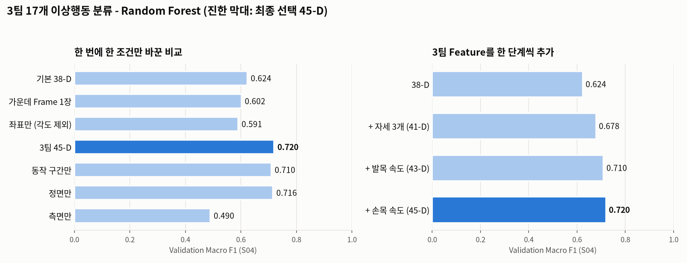
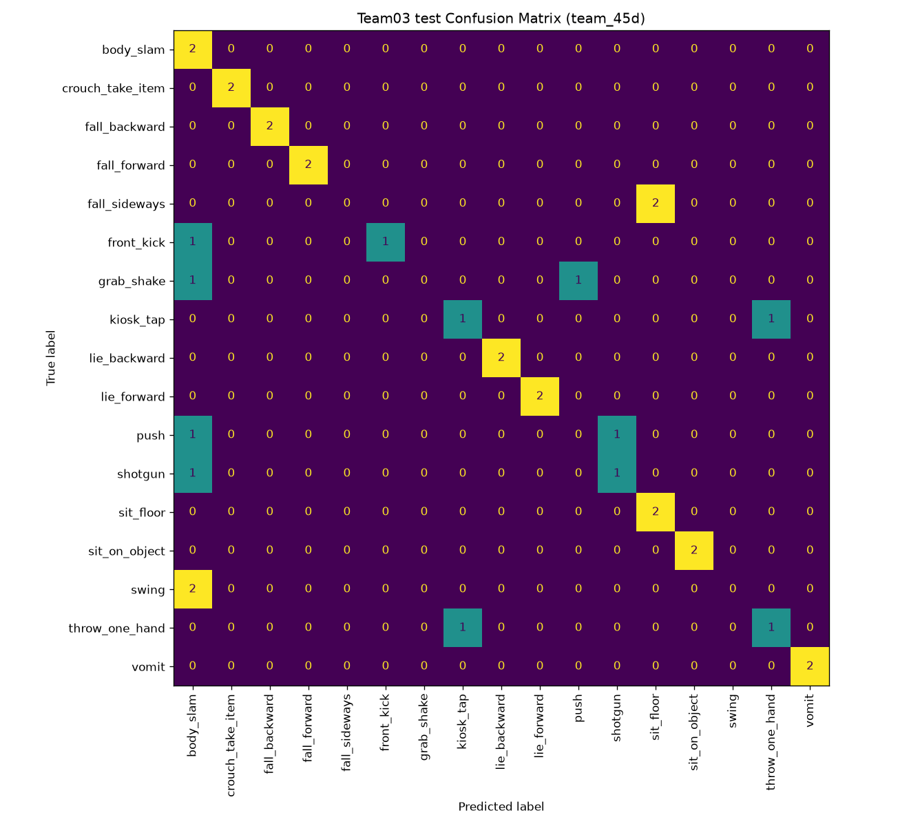

# Subject 10 - Pose Estimation & Action Analysis

YOLO Pose로 찾은 관절을 Feature로 바꾸고, 시간 변화를 Random Forest로 분류해서 동작을 인식하는 프로젝트입니다.
수업 데이터(6개 동작)로 Pipeline을 만들고, 같은 Pipeline을 **3팀 무인 상점 이상행동 17개 동작**(5명 × 17동작 × 정면·측면 = 170개 영상)에 적용했습니다.

3팀 영상은 팀원 5명이 함께 촬영했습니다. 데이터 정리·QA, Feature 설계, 모델 학습·평가, 실시간 인식 연결은 개인 프로젝트로 직접 진행했습니다.
진행하면서 막혔던 문제와 해결 과정은 [`reports/improvement_log.md`](reports/improvement_log.md)에 날짜순으로 적어 두었습니다.

## 핵심 결과

| 항목 | 결과 |
|---|---|
| 데이터 | 3팀 영상 170개, 70,159 Frame 중 Pose 성공 99.7%, 자동 QA + 직접 확인으로 170개 승인 |
| 동작 분류 (17개) | 처음 보는 사람(S05)으로 Test: **Accuracy 0.6471 / Macro F1 0.6020** (기본 38-D는 0.5882), Validation 0.7353 |
| Feature 설계 | 측면 눕기에서 어깨 폭 정규화가 무너짐(차이 8.199) → 상체 길이 기준으로 바꿔 0.438, 팀 Feature 7개 추가로 Validation 오답 13 → 9 |
| 실시간 인식 | 처음 보는 사람 영상에서 Raw 예측 20 / 26 정답, Threshold 조정으로 Stable 일치 비율 0 → 0.65 |

사용한 도구는 YOLO11n-pose(Ultralytics 8.4), OpenCV 5.0, scikit-learn 1.9, pandas · NumPy · Matplotlib입니다.
환경은 Python 3.12, PyTorch 2.15 + CUDA 13.2, RTX 3060, WSL2 Ubuntu입니다.

## Day 01 - Pose 추론 환경

```text
JPG / MP4 / Phone Camera → Frame → YOLO Pose → Person BBox → COCO 17 Keypoint → Skeleton
```

- COCO8-Pose 이미지 8장과 Pose Demo MP4(30 FPS, 60 Frame)에서 사람과 17개 관절을 찾았다.
- 사람이 겹친 이미지에서 차이가 컸다. 049번은 잘 찾았고, 8명이 겹친 110번은 불안정했다.
- 직접 찍은 4가지 자세(옆으로 서기, 쪼그려 앉기, 엎드리기, 벽에 붙어 웅크리기)도 넣어 봤다.
  - 쪼그려 앉기가 가장 잘 나왔다.
  - 벽에 붙어 웅크린 자세는 사람 자체를 못 찾았다.
  - 우리 팀 동작에는 바닥에 눕거나 웅크리는 동작이 많아서, 이후에도 바닥 자세 결과는 따로 확인했다.

## Day 02 - Pose 품질 분석

```text
이미지 · MP4 → YOLO Pose → BBox + 17 Keypoint → Keypoint Confidence → Threshold → 조건별 · Frame별 품질 비교
```

수업 이미지 6장으로 촬영 조건을 비교했다.
- 정면: 평균 Keypoint Confidence 0.975, LOW 관절 0개
- 측면: 0.754, LOW 관절 4개 (오른쪽 눈·귀·팔꿈치·손목)
- 먼 거리: 사람이 절반 크기(BBox 면적 0.300 → 0.149)로 작아져도 0.971로 거의 그대로였다.

거리보다 **방향**이 품질에 더 큰 영향을 줬다. 우리 팀 영상을 정면·측면 2대로 찍어 둔 덕분에, 이 차이를 우리 동작에서도 바로 비교할 수 있었다.

**직접 찍은 동작 영상 36개 (1080×1920, 60 FPS, 정면·측면 카메라 2대)**

| 카메라 | 평균 Confidence | LOW 관절 |
|---|---|---|
| 정면 | 0.96~0.98 | 거의 없음 |
| 측면 | 0.82~0.86 | 거의 모든 Frame에서 4개 (반대쪽 눈·귀·손목) |

- 바닥에 눕거나 엎드린 동작이 가장 불안정했다(평균 0.724, LOW 관절 최대 11개).
- 벽에 붙어 바닥에 웅크린 장면은 1,512 Frame 중 171 Frame에서 사람을 못 찾았다.
- 화면 구석의 물체를 `person 0.35`로 잡은 오검출도 있었다. Person Confidence 기준이 0.25라서 통과한 것이다.
- 측면에서 가려진 팔은 Threshold 0.30에서는 앞쪽 팔 위에 겹쳐 그려졌다. 0.50으로 올리니 빠졌다. 프로젝트에서 쓰는 Keypoint 기준(0.50)이 이런 관절을 걸러 준다는 걸 확인했다.

## Day 03 - Joint Angle, Normalization & Frame Feature

```text
17 Keypoint + Confidence → 관절각도 (Confidence 낮으면 SKIP)
→ Hip Center 이동 + Shoulder Width 정규화
→ Normalized 좌표 34개 + 관절각도 4개 = 38-D Frame Feature → 영상의 각 Frame에 반복
```

수업 이미지로 관절각도를 재 보니, 앉기는 무릎 각도(97.88° / 117.49°)로 서 있는 자세(약 174°)와 확실히 구분됐다. 그런데 팔꿈치 각도는 서기와 앉기가 비슷했다. 각도는 "얼마나 굽혔는지"만 알려 주고, "몸이 어디를 향하는지"는 알려 주지 못했다.

정규화 효과는 숫자로 확인했다.

| 비교 | Pixel 평균 관절 거리 | Normalized 평균 관절 거리 |
|---|---:|---:|
| 같은 사람·같은 자세, 가까이 / 멀리 (직접 촬영) | 163.60 | 0.086 |
| 다른 사람·비슷한 팔 올리기 | 69.40 | 0.339 |
| 왼팔 올리기 vs 오른팔 올리기 (좌우 반전 전 → 후) | - | 0.609 → 0.121 |

- 정규화로 위치·크기 차이는 줄었다. 하지만 사람마다 체형과 팔 각도가 달라서 자세 자체의 차이는 남았다.
- 좌우 반전은 x 부호만 바꾸면 안 되고, Left / Right 관절 번호도 바꿔야 했다.
- 손목이 어깨보다 위인지 보는 규칙은 앉아서 팔을 든 사진도 True로 판정했다. Feature 하나로는 자세를 구분하기 어렵다.

### Confidence가 높은데 관절 위치가 틀린 경우

허리를 숙인 측면 사진에서 왼팔꿈치 각도가 155.81°로 나왔다. 결과 이미지를 열어 보니 왼팔꿈치·손목이 실제 왼팔이 아니라 오른팔 위에 겹쳐 찍혀 있었다.

Confidence가 0.817 / 0.884로 높아서 Confidence 검사로는 걸러지지 않았다. 측면에서는 반대쪽 팔다리가 가려지니까 이런 일이 또 생길 거라고 봤다. 그래서 한쪽 관절이 반대쪽 팔다리 선에 거의 붙어 있으면(overlap < 0.05) Confidence가 낮은 쪽 각도를 SKIP하는 검사를 넣었다.

이미지 8장 중 이 각도 하나만 걸렸다(overlap 0.035). 자세한 기록은 `reports/day03/bend_pose_left_right_check.md`에 있다.

### 우리 팀 동작에서 어깨 폭 정규화가 무너진 문제

3팀 17개 동작(36개 영상)에 같은 방법을 써 보니 두 가지가 막혔다.

1. **무릎 각도로 서기와 눕기를 구분 못 함**: 서기는 161~173°, 눕기는 159~164°였다. 누워 있어도 다리는 펴져 있기 때문이다.
2. **측면 눕기에서 어깨 폭 정규화가 무너짐**: 두 어깨가 겹쳐 어깨 폭이 18.99px까지 작아졌다. 같은 자세인데도 가까이 / 멀리 차이가 8.199로 튀었다.

어깨는 옆에서 보면 겹치지만, 어깨-골반 사이 길이(상체 길이)는 옆에서 봐도 유지된다. 그래서 상체 길이로 나눠 봤다.

| 비교 | 상체 길이 정규화 |
|---|---:|
| 눕기, 가까이 / 멀리 | 0.438 |
| 서기, 가까이 / 멀리 | 0.167 |
| 눕기 vs 서기 | 1.209 |

같은 자세끼리는 가깝고 다른 자세끼리는 멀어졌다.

각도 대신 **상체 기울기, 골반-발목 높이, BBox 가로/세로 비율**을 직접 만들었다. 뒤로 넘어지기 영상에서는 상체 기울기가 서기 약 7°에서 누움 77~93°로 바뀌었고, 3.3~10.6초 동안 유지됐다.

동작마다 잘 드러나는 Feature도 달랐다.
- 키오스크 두드리기: 팔 올림
- 던지기: 손목 속도
- 앞차기: 발목 속도
- 몸통 박치기: 골반 속도

잡고 흔들기·밀치기처럼 물체와 닿는 동작은 Pose만으로는 부족했다.

```text
src/team_features.py   상체 기울기, 골반-발목 높이, BBox 비율, 팔 올림, 발목 높이 차, 속도, 자세 규칙
scripts/team3/         자세 판정, 팀 Feature 추출, 상체 길이 정규화 비교, 동작별 요약
```

## Day 04 - Action Sequence & 3팀 45-D Dataset

```text
Action Clip → Frame → YOLO Pose → 17 Keypoint → Normalization + Joint Angle
→ Frame Feature → 시간 순서 유지 → Sequence → Action Label
```

수업 데이터 6개 동작(824 Frame)은 Pose와 Feature 모두 824 / 824 성공했다. 동작마다 시간에 따라 크게 변하는 값이 달랐다.

| 동작 | 평균 Confidence | 시간에 따라 잘 변한 Feature |
|---|---|---|
| wave | 0.972 | 오른쪽 Wrist y `-0.03 → -3.05 → -0.04`, 오른쪽 Elbow `177° → 116° → 173°` |
| drink_return | 0.954 | 오른쪽 Wrist y `-0.05 → -2.10 → -0.02`, 오른쪽 Elbow `170° → 61° → 172°` |
| bend_return | 0.958 | 양쪽 Wrist y `0 → 0.95 → 0`, Hip Center y `249 → 258 → 250` |
| sit_stand | 0.974 | Knee `160° / 149° → 178° / 173°`, Hip Center y `286 → 250` |
| walk_turn_walk | 0.888 | Hip Center x `472 → 279 → 462` |
| leg_raise_lower | 0.968 | 대표 Frame 5개로는 안 보임 → 9개로 늘리자 오른쪽 Ankle y `2.4 → 1.81` (1.84초) |

- sit_stand 영상은 이름과 달리 앉은 자세로 시작해서 일어서기만 했다. 값을 억지로 맞추지 않고 영상에 있는 그대로 기록했다.
- walk_turn_walk의 인접 Row 변화량(17.478)이 유난히 컸다. 이건 성능이 아니라 방향 전환, 정규화 변화, Keypoint 흔들림이 섞인 값이었다.

**3팀 36개 영상에 적용하면서 생긴 일**
- Pose는 18,950 Frame 중 18,742 (98.9%) 성공했다. 실패한 Frame은 모두 바닥에서 몸을 말거나 엎드린 장면이었다.
- 같은 동작의 정면·측면 결과가 같은 이름으로 저장돼서 서로 덮어썼다. Label에 `_front` / `_side`를 붙여 36개를 따로 남겼다.
- 휴대폰 영상은 영상 정보에 적힌 Frame 수가 실제보다 1~6개 많았다. 그래서 마지막 Frame을 읽다가 멈췄다. 실제로 읽히는 Frame을 기준으로 대표 Frame을 뽑도록 고쳤다(108장).
- 뒤로 넘어지기와 앞으로 넘어지기는 시작·끝 자세가 똑같았다. 둘의 차이는 중간에만 있었다.
  - 뒤로 넘어지기: 골반이 1초 안에 약 190px 내려가 그대로 머물렀다.
  - 앞으로 넘어지기: 골반이 1초에 약 380px 앞으로 이동했다.
  - Frame 한 장이 아니라 Sequence가 필요한 이유를 우리 데이터에서 직접 본 사례였다.

**170개 전체를 45-D Sequence로**

```text
S0x_A0nn_T0t.mp4 (5명 × 17동작 × 정면·측면, 실명 대신 S01~S05)
→ Clip Manifest → Keypoint Dataset (Pixel 좌표 + Confidence + BBox)
→ 자동 QA (AUTO_PASS 166 / CHECK 4) → 직접 확인 (PASS 170)
→ 동작 시작·끝 구간 (in_action 표시)
→ 38-D + 3팀 7개 = 45-D Sequence 170개
```

추가한 7개는 3일차에 막혔던 문제에서 나왔다.
- `torso_tilt_deg`, `bbox_aspect_ratio`, `hip_floor_height`: 눕기·쓰러짐을 구분하려고 넣었다.
- `left/right_ankle_speed`, `left/right_wrist_speed`: 차기·던지기·두드리기를 구분하려고 넣었다.

속도는 처음에 인접 Frame끼리 계산했는데, 60 FPS라 관절이 조금만 떨려도 값이 크게 튀었다. 그래서 0.1초(6 Frame) 간격으로 비교하고, 영상마다 상체 길이로 나눴다.

처음 후보에는 "발과 문 사이 거리"도 있었다. 하지만 영상에 문·물체 위치 정보가 없어서 계산할 수 없었고, 손목 속도로 대신했다.

결과: 70,159 Frame 중 Pose 성공 69,926 (99.7%), 45-D 성공 68,813. 측면에서 눕기·쓰러짐은 BBox 비율 2.4~3.2, 골반-바닥 높이 0.3~0.5가 나왔다. 서서 하는 동작(약 0.5 / 1.6)과 확실히 갈렸다.

보고서: `reports/team_projects/team03/team03_data_preparation_report.md`

## Day 05 - Keypoint Dataset QA & Subject-wise Split

```text
MP4 → Keypoint Dataset → 자동 QA → 직접 확인 → Approved Clips → Subject-wise Split → Leakage check
```

| | 수업 데이터 (6동작 × 3명) | 3팀 (17동작 × 5명 × 정면·측면) |
|---|---|---|
| 자동 QA | AUTO_PASS 13 / CHECK 5 | AUTO_PASS 166 / CHECK 4 |
| Approved | 18 | 170 |
| Train / Validation / Test | S01 / S02 / S03 | S01~S03 (102) / S04 (34) / S05 (34) |

- 수업 데이터에서 CHECK가 5개나 나왔다. 원본을 열어 보니 옷걸이에 걸린 외투를 두 번째 사람으로 잡은 것이었다. 자동 QA 숫자만 믿었으면 멀쩡한 Clip 5개를 버릴 뻔했다.
- Frame 단위로 무작위로 나눠 보니(Train 1,946 / Test 487 Frame) 3명 모두, Clip 18개 모두가 Train과 Test 양쪽에 들어갔다.
  - 이러면 모델이 같은 사람의 같은 동작을 외워도 점수가 잘 나온다.
  - 우리가 알고 싶은 건 "처음 보는 사람의 동작도 맞히는가"였다.
  - 그래서 사람 단위로 나눴다. 3팀은 5명 중 3명으로 학습하고, 1명으로 조건을 고르고, 남은 1명으로 마지막에 한 번 평가했다.
- 3팀 동작은 동작마다 봐야 할 관절이 달랐다. 그래서 Keypoint 추출·QA 기준을 17개 동작에 맞게 다시 만들었다(`scripts/team03/`).
- 측면 영상은 반대쪽 관절이 가려져서 QA에 자주 걸렸다. 판단에 필요한 참고 열 3개를 추가했더니 CHECK가 왜 났는지 바로 보였다.

## Day 06 - Action Recognition

```text
Keypoint CSV → Frame Feature → Sequence Resampling (30 Step)
→ Random Forest (300 Tree) → Validation → 오분류 분석 → Feature 비교 → Final Test
```

모델은 Random Forest로 시작했다. 학습 Clip이 102개라 많지 않았다. 또 어떤 Feature가 판단에 쓰였는지 중요도로 확인할 수 있어서, Feature를 직접 설계하는 이번 작업에 맞았다.

동작마다 Clip 수가 같으니 Accuracy도 볼 수 있다. 그래도 조건을 고르는 기준은 **Macro F1**로 정했다. 17개 동작을 똑같은 무게로 보고 싶었고, 특정 동작 몇 개만 잘 맞히는 조건이 뽑히는 걸 막고 싶었다.

먼저 수업 데이터(Train 6 / Validation 6 Clip)로 돌려 봤다.
- Sequence는 0.5000이었는데, Static은 0.6667, 좌표만 쓴 조건은 1.0000이 나왔다.
- wave Clip 하나는 두 동작의 투표가 0.22 근처로 거의 같아서 작은 차이에도 결과가 뒤집혔다.
- Train이 6개뿐이라 이 결과를 그대로 믿을 수 없었다. 같은 비교를 3팀 데이터로 다시 해 봤다.

**3팀 17개 동작 - 한 번에 한 조건만 바꿔 Validation(S04)으로 비교**

| 조건 | Feature | Validation Accuracy | Validation Macro F1 |
|---|---:|---:|---:|
| Baseline (38-D) | 1,140 | 0.6176 | 0.6235 |
| Static (가운데 Frame) | 38 | 0.6471 | 0.6020 |
| 좌표만 | 1,020 | 0.6176 | 0.5905 |
| **3팀 45-D** | 1,350 | 0.7353 | **0.7196** |
| 동작 구간만 | 1,140 | 0.7353 | 0.7098 |
| 정면만 / 측면만 | 1,140 | 0.7647 / 0.5882 | 0.7157 / 0.4902 |



- 3팀 Feature 7개를 넣은 45-D가 Macro F1이 가장 높았다. 오답이 13개에서 9개로 줄었다.
- "동작 구간만"도 같은 9개까지 줄었지만 고르지 않았다.
  - Macro F1 기준으로는 45-D가 더 높았다.
  - 실시간에서는 동작이 언제 시작하고 끝나는지 미리 알 수 없어서, 구간을 잘라 주는 조건은 그대로 쓸 수 없었다.
- 각도를 빼면 맞힌 개수는 같았지만 Macro F1이 떨어졌다. Static은 Accuracy가 조금 높았지만 Macro F1은 낮아서, 이 Validation만으로는 Sequence와 Static의 차이를 말하기 어려웠다.
- Feature를 한 번에 다 넣지 않고 한 단계씩 늘려 봤다.
  - 자세 3개 → 0.6784, 발목 속도 → 0.7098, 손목 속도 → 0.7196으로 단계마다 올랐다.
  - 동작별로 보면 득실이 섞였다. 손목 속도를 넣자 샷건·앞차기는 좋아졌지만 휘두르기와 넘어지기 2개는 떨어졌다.

**Final Test (S05, 34개)**: 45-D가 Accuracy 0.6471 / Macro F1 0.6020(22 / 34)였다. 같은 Test에서 기본 38-D는 0.5882 / 0.5652였다.



17개 중 9개 동작은 2개를 모두 맞혔다. 틀린 12개는 대부분 팔·다리를 쓰는 서서 하는 동작이었다.
- 휘두르기 2개, 밀치기·앞차기·샷건·잡고 흔들기 각 1개 → 몸통 박치기 (6개)
- 밀치기 → 샷건, 잡고 흔들기 → 밀치기, 두드리기 ↔ 던지기
- 옆으로 쓰러지기 2개 → 바닥에 앉기

밀치기·잡고 흔들기·샷건은 사람 자세만 보면 거의 같다. 실제로 다른 건 앞에 있는 물체(사람이냐 뽑기기계냐 테이블이냐)였다.

Validation은 0.7353인데 Test는 0.6471이었다. 팀에서 사람 번호를 다시 정하기 전에는 같은 방법으로 Test가 0.7647이었다. **Test하는 사람이 누구냐에 따라 10%p 넘게 달라졌다.** 그래서 한 사람으로 낸 점수 하나를 성능으로 믿지 않고, 5명을 돌아가며 평가해 보려고 한다.

결과: `reports/day06/challenge/mini_challenge_result.md`, `reports/team_projects/team03/feature_expansion_log.md`

```text
scripts/team03/team_day06_baseline.py   조건 비교 실험 · 모델과 학습 정보 저장
scripts/team03/team_readme_figures.py   README 결과 그림 생성
```

## Day 07 - Sliding Window Realtime Action Recognition

학습한 모델을 저장영상과 스마트폰 카메라 Stream(1280×720)의 연속 Frame에 연결했다.

```text
Saved MP4 / Phone Camera Stream
→ YOLO Pose → Frame Feature
→ Timed Sliding Window (최근 5초, 80% 이상 차면 예측)
→ 30 Step Resampling → Random Forest (0.25초마다)
→ Confidence Threshold (미만이면 UNKNOWN)
→ Stabilization (최근 5개 중 3표) → Stable Action
```

먼저 수업 모델로 저장영상(S02)을 돌려 봤다.

| 실험 | Prediction | UNKNOWN 비율 | 평균 Confidence |
|---|---:|---:|---:|
| wave, Window 5초 | 0 | - | - |
| wave, Window 3초 / 2초 | 5 / 8 | 1.0 / 1.0 | 0.249 / 0.260 |
| walk_turn_walk, 기본 (Threshold 0.55, Buffer 5) | 21 | 1.0 | 0.231 |
| walk_turn_walk, Threshold 0.40 / 0.70 | 21 / 21 | 1.0 / 1.0 | 0.231 |
| walk_turn_walk, Buffer 3 / 7 | 21 / 21 | 1.0 / 1.0 | 0.231 |

- wave 영상은 3.76초라 Window 5초의 80%(4초)를 못 채워서 예측이 0번이었다. Window를 줄이자 예측이 나왔고, Raw는 대부분 wave였다.
- walk_turn_walk의 Raw는 21번 중 정답이 1번뿐이었다(대부분 drink_return).
- Confidence가 0.2대라 Threshold나 Buffer를 바꿔도 전부 UNKNOWN이었다. 한 사람의 6개 Clip으로만 학습해서 투표가 여러 동작으로 갈라진 것으로 본다.

**3팀 모델로 실시간 실행 - A007 바닥에 앉기**

17개 중 A007을 고른 이유는 세 가지다.
- 6일차 Test에서 정면·측면 모두 맞힌 동작이다.
- 영상이 10초가 넘어 Window를 채울 수 있다. 3팀 영상 170개 중 74개는 5초도 안 됐다.
- 넘어지기·쓰러지기와 달리 카메라 앞에서 안전하게 다시 해 볼 수 있다.

학습에 쓰지 않은 S05 영상(10.9초)을 넣었다.

| Threshold | UNKNOWN 비율 | Stable 일치 비율 | Raw 정답 |
|---:|---:|---:|---:|
| 0.55 (기본) | 1.00 | 0.00 | 20 / 26 |
| 0.20 | 0.35 | 0.65 | 20 / 26 |

- 모델은 26번 중 20번을 `sit_floor`로 맞게 봤다. 틀린 6번은 앉기 전·일어난 뒤 자세가 Window에 섞인 앞뒤 구간이었다.
- 그런데 Confidence가 0.12~0.34라 기본 기준 0.55에서는 전부 UNKNOWN으로 보류됐다.
- 17개 동작이면 투표가 비슷한 동작들로 나뉘어서, 6개 동작일 때보다 Confidence가 원래 낮게 나온다.
- 그래서 실제 Confidence 범위(평균 0.25)보다 조금 낮은 0.20으로 Threshold 하나만 바꿔 다시 돌렸다.
- 0.20에서는 5.9~10.1초 구간이 Stable `sit_floor`가 됐다. 틀린 Raw 6개(0.12~0.18)는 0.20을 넘지 못했다.
- 다만 이 값은 한 동작에서만 확인한 것이다. 혼동이 많았던 밀치기·잡고 흔들기·샷건에서도 틀린 예측이 걸러지는지는 아직 확인하지 않았다.

처리 속도는 수업 영상(640×480)이 37 FPS, 3팀 영상(1080×1920)이 22 FPS였다. 해상도가 큰 3팀 영상이 더 느렸다.

결과: [`mini_challenge_summary.md`](reports/day07/challenge/team03/mini_challenge_summary.md), [`runtime_comparison.md`](reports/day07/runtime_comparison.md), [`fps_test.md`](reports/day07/fps_test.md)

```text
scripts/team03/team_day07_runtime.py   3팀 모델 · 17개 동작 이름표로 저장영상 / 카메라 실시간 실행
scripts/team03/team_record_clip.py     폰 Stream으로 평가용 영상 녹화
```

## 아직 부족한 점

- **물체와 닿는 동작끼리 헷갈린다.**
  - Test 오답 12개 중 10개가 서서 팔·다리를 쓰는 동작끼리였다. 밀치기는 Validation·Test 모두 한 번도 맞히지 못했다.
  - 키오스크·뽑기기계 같은 물체 위치(ROI나 객체 검출)와 손-물체 거리를 Feature로 넣어 보고 싶다.
- **정면 카메라에서 누운 자세가 약하다.**
  - 측면에서는 BBox 비율·골반 높이로 잘 갈렸다.
  - 정면에서는 카메라 쪽으로 누워서 구분이 약했다.
  - 카메라 높이를 바꾸거나 정면·측면 결과를 합치는 방법을 생각하고 있다.
- **"정상 vs 이상"은 아직 판단할 수 없다.** 데이터가 이상행동 17개뿐이라, 걷기·물건 고르기 같은 정상행동 영상이 필요하다.
- **평가 인원이 적다.**
  - Validation과 Test가 각각 한 사람(34개)이다.
  - Clip 하나만 틀려도 Accuracy가 약 0.03씩 움직이고, Test 사람이 바뀌자 0.76 → 0.65로 달라졌다.
  - 5명을 한 명씩 Test로 빼서 평균을 내는 평가가 필요하다.
- **실시간 Threshold를 한 동작에서만 정했다.**
- **짧은 동작을 놓친다.** 5초 Window는 4초를 채워야 예측을 시작해서, 짧은 두드리기·던지기는 Window를 줄이거나 동작 구간을 따로 찾아야 한다.
- **한 사람만 본다.** 지금은 가장 확실한 사람 한 명만 분류한다. 무인 상점처럼 여러 명이 있으면 사람을 계속 따라가는 Tracking이 필요하다.
- **Random Forest 하나만 써 봤다.** 시간 순서를 직접 다루는 시계열 모델(LSTM 등)과는 아직 비교하지 않았다.
