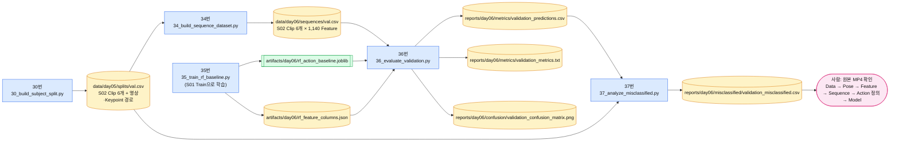
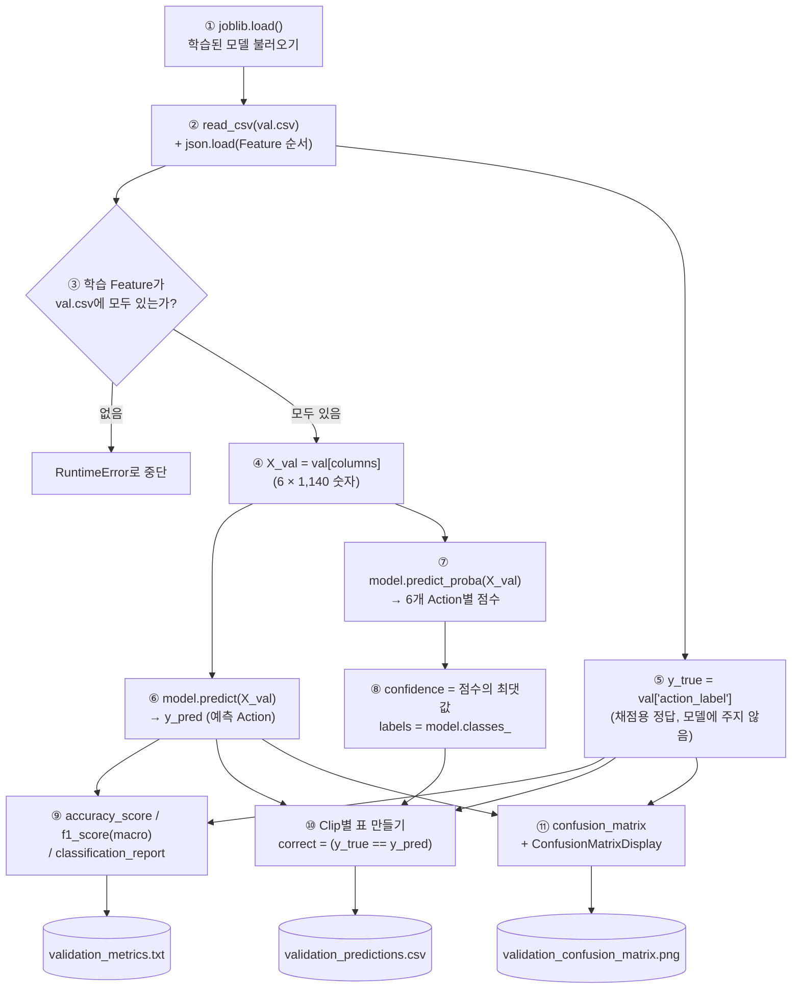
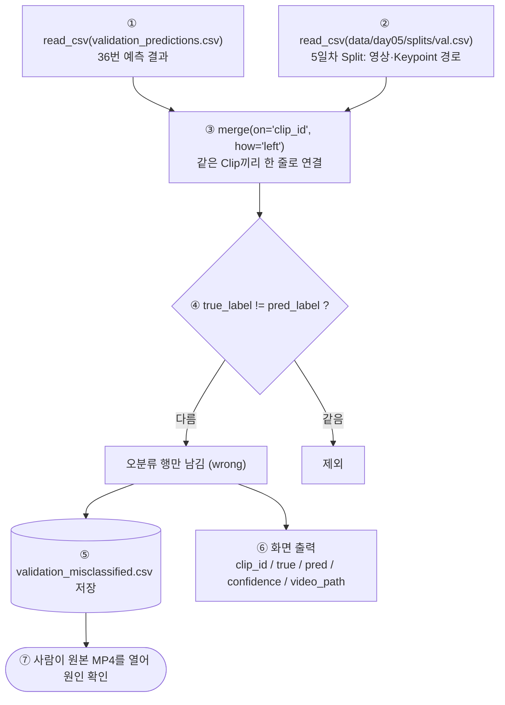

# 6일차 36·37번 코드 파이프라인

`scripts/36_evaluate_validation.py`와 `scripts/37_analyze_misclassified.py`를 읽고
입력 → 처리 → 출력 흐름을 정리했다.

## 1. 전체에서의 위치



- 파란 사각형 = Python 코드, 노란 원통 = 자동 생성 파일, 초록 = 학습된 모델, 분홍 = 사람이 하는 일
- 36번은 **모델을 다시 학습하지 않는다** (`fit` 없음, `predict`만 사용).
- 37번은 **모델을 쓰지 않는다**. 36번 결과 표와 5일차 표를 이어 붙이는 분석 도구다.

## 2. 36번 `36_evaluate_validation.py` — Validation 평가

### 입력 / 출력

| 구분 | 파일 | 만든 코드 | 내용 |
|---|---|---|---|
| 입력 | `artifacts/day06/rf_action_baseline.joblib` | 35번 | S01로 학습한 Random Forest |
| 입력 | `artifacts/day06/rf_feature_columns.json` | 35번 | 학습 때 사용한 Feature 1,140개의 이름과 **순서** |
| 입력 | `data/day06/sequences/val.csv` | 34번 | S02 Clip 6개, 한 행 = Clip 하나 (메타 8열 + Feature 1,140열) |
| 출력 | `reports/day06/metrics/validation_metrics.txt` | 36번 | Accuracy, Macro F1, Classification Report |
| 출력 | `reports/day06/metrics/validation_predictions.csv` | 36번 | Clip별 `true_label`, `pred_label`, `confidence`, `correct` |
| 출력 | `reports/day06/confusion/validation_confusion_matrix.png` | 36번 | 혼동행렬 (행 = 실제, 열 = 예측) |

### 처리 흐름



### 핵심 포인트

- **Feature 순서 맞추기**: 학습 때 `t00_nose_x, t00_nose_y, …` 순서로 넣었으면 평가 때도 같은 순서여야 한다. 그래서 35번이 순서를 JSON으로 저장하고, 36번이 그 순서대로 열을 골라 넣는다(③④).
- **정답은 모델에 넣지 않는다**: `action_label`은 `y_true`로만 쓰이고 `X_val`에서는 빠진다. 정답을 넣으면 시험지에 답을 적어 주는 것과 같다.
- **Confidence는 투표 비율**: Random Forest 300그루 중 그 Action에 투표한 비율이다. 정답일 확률로 해석하지 않는다.
- **동점이면 이름순 앞쪽이 선택된다**: `predict`는 점수가 가장 큰 Class를 고르는데, 같으면 `classes_` 순서(알파벳순)에서 앞에 있는 것이 된다.

### 이번 실행 결과

| clip_id | 실제 | 예측 | confidence | 결과 |
|---|---|---|---:|---|
| S02_A001_T01 | bend_return | bend_return | 0.2967 | 정답 |
| S02_A002_T01 | leg_raise_lower | leg_raise_lower | 0.3200 | 정답 |
| S02_A003_T01 | walk_turn_walk | leg_raise_lower | 0.2133 | 오답 |
| S02_A004_T01 | drink_return | wave | 0.2267 | 오답 |
| S02_A005_T01 | sit_stand | sit_stand | 0.3167 | 정답 |
| S02_A006_T01 | wave | drink_return | 0.2200 | 오답 (wave도 0.2200, 동점) |

- Validation Accuracy 0.5000, Macro F1 0.4444 (교재 0.6667 / 0.5556)
- S02_A006_T01은 wave와 drink_return 점수가 0.2200으로 같아 이름순 앞쪽인 drink_return이 선택됐다. 교재 환경에서는 wave가 0.2233으로 앞서 정답이었다. YOLO 버전·GPU가 달라 Keypoint 좌표가 소수점 단위로 달라진 영향이다.

## 3. 37번 `37_analyze_misclassified.py` — 틀린 Clip을 원본과 연결

### 입력 / 출력

| 구분 | 파일 | 만든 코드 | 내용 |
|---|---|---|---|
| 입력 | `reports/day06/metrics/validation_predictions.csv` | 36번 | Clip별 정답·예측 |
| 입력 | `data/day05/splits/val.csv` | 5일차 30번 | `clip_id`, `video_path`, `keypoint_csv`, `action_label` |
| 출력 | `reports/day06/misclassified/validation_misclassified.csv` | 37번 | 틀린 Clip + 원본 MP4 경로 + Keypoint CSV 경로 |

### 처리 흐름



### 핵심 포인트

- 예측 결과 표에는 "어떤 Clip이 틀렸는지"만 있고, 원본 영상 위치는 5일차 Split 표에 있다. 두 표를 **`clip_id`로 이어 붙여** 원본까지 바로 따라갈 수 있게 한다.
- 37번은 모델을 고치거나 다시 학습하지 않는다. **틀린 원인을 사람이 찾도록 목록을 만드는 단계**다.
- 오분류가 0개이면 헤더만 있는 CSV가 저장되고 "Validation 오분류가 없습니다."를 출력한다.

### 이번 실행 결과

```text
Validation clips : 6
Misclassified    : 3

S02_A003_T01  walk_turn_walk → leg_raise_lower  0.2133  data/day05/videos/S02/S02_A003_T01.mp4
S02_A004_T01  drink_return   → wave             0.2267  data/day05/videos/S02/S02_A004_T01.mp4
S02_A006_T01  wave           → drink_return     0.2200  data/day05/videos/S02/S02_A006_T01.mp4
```

원본에서 확인할 것 (교재 27번)

- walk_turn_walk → leg_raise_lower: 걷는 동안 다리를 드는 장면이 다리 들기와 비슷하게 표현됐는가? 회전 구간에서 Pose가 흔들렸는가?
- drink_return ↔ wave: 둘 다 오른팔을 얼굴·머리 높이까지 올렸다 내리는 동작이라 팔 움직임이 비슷하다. 30 Step으로 줄이면서 "흔들기 반복"과 "입에 대고 멈춤"의 차이가 약해졌을 수 있다.

## 4. 같은 이름이지만 다른 두 `val.csv`

| | `data/day05/splits/val.csv` | `data/day06/sequences/val.csv` |
|---|---|---|
| 만든 코드 | 5일차 30번 | 6일차 34번 |
| 한 행 | Clip 하나의 **정보** | Clip 하나의 **숫자 Feature** |
| 원본 영상·Keypoint 경로 | 있음 (`video_path`, `keypoint_csv`) | 없음 |
| 1,140개 Feature | 없음 | 있음 (`t00_nose_x` ~ `t29_right_knee_angle`) |
| `action_label` | 있음 | 있음 |
| 36·37번에서 | **37번**이 원본 경로를 찾으려고 읽음 | **36번**이 모델 입력으로 읽음 |

## 5. 3팀 버전에서는

3팀 Mini Challenge(`scripts/team03/team_day06_baseline.py`)는 36·37번 역할을 함수 하나(`evaluate()`)에서 함께 한다.

| 교재 | 3팀 |
|---|---|
| 36번 `validation_metrics.txt` | `reports/team_projects/team03/day06/validation/validation_metrics_<조건>.txt` |
| 36번 `validation_predictions.csv` | `.../validation_predictions_<조건>.csv` (예측 표에 `video_path`를 바로 포함) |
| 36번 혼동행렬 PNG | `.../validation_confusion_<조건>.png` (17 × 17) |
| 37번 `validation_misclassified.csv` | `.../validation_misclassified_baseline_38d.csv` |

예측 표를 만들 때 원본 경로(`video_path`)를 같이 넣어서, 37번처럼 표 두 개를 다시 합칠 필요가 없게 했다.
