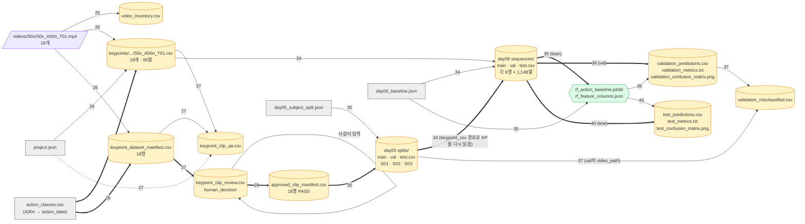

# 3팀 4~6일차 Action 학습 파이프라인

- 제출용 그림: `3팀_Action_학습파이프라인.png`
- 수정용 원본: `3팀_Action_학습파이프라인.drawio` (diagrams.net에서 열기)
- 그림 만드는 코드: `draw_pipeline.py`

![[3팀_Action_학습파이프라인.png]]

---

## 1. 코드 + 파일 파이프라인 (그림과 같은 내용)

모양 규칙: 회색 = 직접 작성한 설정, 보라 = 원본 영상, 파랑 = Python 코드, 노랑 = 자동 생성 CSV·결과, 초록 = 학습 모델, 분홍 = 사람.
**빨간 선** = `action_label`(정답)이 함께 이동하는 길.

```mermaid
flowchart LR
    subgraph D5["5일차 — Keypoint Dataset · QA · Split"]
        MP4[/"data/day05/videos/<br/>MP4 18개 (S01~S03)"/]
        PJ["configs/project.json"]
        AC["configs/action_classes.csv"]
        C25("25_check_day05_data.py")
        INV[("reports/day05/tables/<br/>video_inventory.csv")]
        C26("26_extract_keypoint_dataset.py")
        KP[("data/day05/keypoints/<br/>S0x/label/*.csv × 18")]
        KM[("manifests/<br/>keypoint_dataset_manifest.csv")]
        C27("27_keypoint_qa.py")
        QA[("qa/keypoint_clip_qa.csv")]
        RV[("qa/keypoint_clip_review.csv")]
        HQ(["사람: Human QA<br/>human_decision 입력"])
        C28("28_validate_human_review.py")
        C29("29_build_approved_manifest.py")
        AP[("manifests/<br/>approved_clip_manifest.csv")]
        SJ["configs/day05_subject_split.json"]
        C30("30_build_subject_split.py")
        TR5[("splits/train.csv · S01")]
        VA5[("splits/val.csv · S02")]
        TE5[("splits/test.csv · S03")]
        C31("31_check_split_leakage.py")
    end
    subgraph D6["6일차 — Sequence · Random Forest · 평가"]
        BJ["configs/day06_baseline.json"]
        SU["src/sequence_utils.py"]
        C34("34_build_sequence_dataset.py")
        TR6[("sequences/train.csv")]
        VA6[("sequences/val.csv")]
        TE6[("sequences/test.csv")]
        C35("35_train_rf_baseline.py")
        M{{"rf_action_baseline.joblib"}}
        FJ{{"rf_feature_columns.json"}}
        C36("36_evaluate_validation.py")
        VO[("validation_predictions.csv<br/>metrics.txt · confusion.png")]
        C37("37_analyze_misclassified.py")
        MC[("validation_misclassified.csv")]
        H2(["사람: 원본 MP4 확인"])
        C40("40_evaluate_test.py")
        TO[("test_predictions.csv<br/>test_metrics.txt · confusion.png")]
    end

    MP4 -- MP4 --> C25 --> INV
    MP4 -- Frame --> C26
    PJ -- YOLO 설정 --> C26
    PJ -. keypoint_confidence .-> C27
    AC == "A006 → wave" ==> C26
    C26 == "관절 + action_label" ==> KP
    C26 ==> KM ==> C27
    KP -. 관절 Conf .-> C27
    C27 --> QA
    C27 ==> RV
    RV --> HQ --> RV
    RV -.-> C28
    RV ==> C29 ==> AP ==> C30
    SJ --> C30
    C30 ==> TR5 & VA5 & TE5
    TR5 & VA5 & TE5 -.-> C31
    TR5 & VA5 & TE5 == "keypoint_csv 경로 + label" ==> C34
    BJ --> C34
    SU --> C34
    C34 ==> TR6 & VA6 & TE6
    TR6 == "X_train · y_train" ==> C35
    BJ --> C35
    C35 --> M & FJ
    VA6 == "X_val · y_true" ==> C36
    M & FJ --> C36
    C36 ==> VO --> C37
    VA5 -- video_path --> C37
    C37 --> MC --> H2
    TE6 == "X_test · y_true" ==> C40
    M & FJ --> C40
    C40 ==> TO

    classDef cfg fill:#eeeeee,stroke:#555;
    classDef raw fill:#ede9fe,stroke:#7c3aed;
    classDef code fill:#dbeafe,stroke:#2563eb;
    classDef csv fill:#fef3c7,stroke:#d97706;
    classDef model fill:#dcfce7,stroke:#16a34a;
    classDef human fill:#fce7f3,stroke:#db2777;
    class PJ,AC,SJ,BJ cfg;
    class MP4 raw;
    class C25,C26,C27,C28,C29,C30,C31,C34,C35,C36,C37,C40,SU code;
    class INV,KP,KM,QA,RV,AP,TR5,VA5,TE5,TR6,VA6,TE6,VO,MC,TO csv;
    class M,FJ model;
    class HQ,H2 human;
    linkStyle default stroke:#6b7280;
```

---

## 2. 파일끼리 연결되는 파이프라인

코드를 상자로 그리지 않고 **파일 → 파일**만 이었다. 화살표 위 숫자는 그 파일을 만드는(변환하는) **코드 번호**다.



### 파일 연결표

| 만들어지는 파일 | 읽는 파일 | 만드는 코드 | 연결 열쇠 |
|---|---|---|---|
| `reports/day05/tables/video_inventory.csv` | MP4 18개 | 25 | 파일 경로 |
| `data/day05/keypoints/S0x/<label>/<clip_id>.csv` | MP4, `project.json`, `action_classes.csv` | 26 | 파일명의 `A00n` → `action_label` |
| `data/day05/manifests/keypoint_dataset_manifest.csv` | (26이 처리한 Clip 목록) | 26 | `clip_id`, `keypoint_csv` 경로 |
| `data/day05/qa/keypoint_clip_qa.csv`, `keypoint_clip_review.csv` | manifest, Keypoint CSV, `project.json` | 27 | `keypoint_csv` 경로 |
| `keypoint_clip_review.csv` (수정) | 원본 MP4 | **사람** | `video_path` |
| `data/day05/manifests/approved_clip_manifest.csv` | review CSV | 29 | `human_decision == PASS` |
| `data/day05/splits/train·val·test.csv` | approved manifest, `day05_subject_split.json` | 30 | `subject` (S01/S02/S03) |
| `data/day06/sequences/train·val·test.csv` | day05 splits → 그 안의 `keypoint_csv` 경로로 Keypoint CSV, `day06_baseline.json` | 34 | `keypoint_csv` 경로 |
| `artifacts/day06/rf_action_baseline.joblib`, `rf_feature_columns.json`, `rf_training_info.json` | `sequences/train.csv`, `day06_baseline.json` | 35 | Feature 열 이름(`t00_nose_x` …) |
| `reports/day06/metrics/validation_*`, `confusion/validation_confusion_matrix.png` | `sequences/val.csv`, 모델, Feature 순서 JSON | 36 | Feature 열 순서 |
| `reports/day06/misclassified/validation_misclassified.csv` | validation_predictions.csv, `data/day05/splits/val.csv` | 37 | `clip_id` |
| `reports/day06/metrics/test_*`, `confusion/test_confusion_matrix.png` | `sequences/test.csv`, 모델, Feature 순서 JSON | 40 | Feature 열 순서 |

### 정답(`action_label`)이 이동하는 길

```text
configs/action_classes.csv (A006 → wave)
  → 26: Keypoint CSV · manifest의 action_label
  → 27: review CSV
  → 29: approved_clip_manifest.csv
  → 30: day05 splits/*.csv
  → 34: day06 sequences/*.csv
  → 35: y_train (학습)            → 모델(.joblib)이 예측을 만든다
  → 36·40: y_true (채점 전용)     → predictions.csv에서 true_label vs pred_label 비교
```
